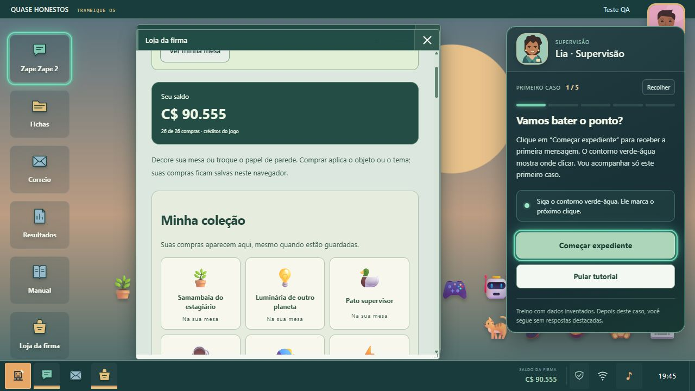

# Auditoria do Quase Honestos — 27/10/2026

## Ambiente e método

Revisão do jogo publicado e de seu build local, no navegador Chromium do ambiente de desenvolvimento. O repositório e o README foram enviados à branch `main` antes da revisão; as correções identificadas ficam no mesmo repositório.

| Resolução | Layout exercitado |
|---|---|
| 360×800 | Celular estreito |
| 390×844 | Celular |
| 768×1024 | Tablet em pé |
| 1366×768 | Notebook |
| 1920×1080 | Monitor |

Esses tamanhos cobrem os principais tipos de layout do projeto. Não representam uma classificação estatística dos cinco aparelhos mais vendidos.

## Cobertura executada

- **2.400 verificações de layout:** 120 alternativas dos 30 casos × duas faixas etárias × demonstração/resultado × cinco resoluções. A leitura automatizada examinou largura do documento, limites das janelas, conteúdo interno e textos inválidos (`undefined`, `NaN`, objetos convertidos em texto).
- **1.050 verificações de vingança:** para cada um dos 30 casos, pergunta inicial, cinco etapas animadas e recibo final nas cinco resoluções. Mais **150 verificações** das perguntas com texto infantil.
- **510 repetições** dos cenários sinalizados pelo primeiro teste de largura, após a correção compartilhada. Sem repetição do alerta original.
- **35 repetições** das etapas da vingança de entrega após ajustar a esteira. Sem excesso de largura.
- **265 verificações auxiliares:** introdução, Fichas, Manual, Resultados, loja vazia/completa, cinco resumos intermediários, três resultados finais e mensagens do Correio nas duas faixas. Os 18 tipos de recado foram incluídos; algumas telas foram repetidas.
- **30 sequências de navegação:** abrir e fechar os seis aplicativos nos cinco tamanhos. No celular, escolher um app fecha o alternador e mostra o app escolhido.
- Primeiro cadastro por clique e retorno nos cinco tamanhos: nome, personagem e faixa preservados; pergunta de idade não reaparece.
- Aviso inicial nos cinco tamanhos: dentro da tela, sem rolagem horizontal; botão bloqueado sem a caixa marcada; Escape não dispensa o aviso. Não foi aceito um termo em nome do usuário para executar essa verificação.
- Compra dos **26 produtos pela interface** nos cinco tamanhos. Comandos de guardar/recolocar objeto conferidos. Após recarregar, a coleção continuou com 26 itens, sem oferecer uma segunda compra dos mesmos produtos. Os créditos usados nesse teste foram gerados pelo fixture local.
- Uma vingança foi jogada por cliques desde a pergunta inicial, com um erro e correção, até terminar as cinco etapas e receber C$ 160 (dois acertos de primeira). As demais etapas e perguntas foram exercitadas por testes de integração e estados visuais isolados, não por 30 sessões manuais completas em cada aparelho.

As verificações de layout são medições do DOM, complementadas por inspeção de screenshots. Não significam milhares de screenshots revisados individualmente por uma pessoa. As demonstrações foram amostradas durante a execução; isso não equivale a inspeção de cada quadro de todas as animações.

## Percursos completos de integração

`tests/full-campaign-audit.test.mjs` percorre os 30 casos e seis dias nas duas faixas etárias, tanto no caminho seguro quanto no parcial. Salva e carrega a cada atendimento, verifica a identidade do caso, contagem de alternativas, bônus de tutorial, etapas/recompensa da vingança, pausa entre dias, compras e término da campanha. O caminho parcial não libera vingança.

A suíte existente também percorre as quatro alternativas por caso e faixa, incluindo perdas, ransomware, prevenção de cliques repetidos e liquidação única; todas as respostas do Correio; créditos negativos; compra duplicada; eventos de som e relógios de animação. Resultado final desta rodada: **922 testes aprovados, zero falhas**, executados com `npm test`; build `v20261027d` concluído.

## Bugs encontrados e corrigidos

1. **Resumo perdia dados do atendimento.** `finishCall` não guardava `audience`, `partial`, humor e semente da ordem. Uma pausa podia ser contada como proteção completa e uma revisão infantil usar outra versão. Esses dados agora seguem no histórico; salvamentos antigos recuperam a pausa parcial quando o feedback registrado a identifica inequivocamente.
2. **Rodapé bloqueava o primeiro login no PC.** A área do rodapé cobria o centro do botão de envio em 1366×768. Enter funcionava, mas o mouse era interceptado. O rodapé, que contém apenas texto, deixou de receber eventos de ponteiro. O cadastro por clique foi repetido nos cinco tamanhos.
3. **Halo invisível criava largura extra.** O pseudo-elemento do clique crescia até 1,55× e aumentava a largura rolável mesmo transparente. O halo agora fica dentro do botão. Os 102 cenários sinalizados foram repetidos nas cinco resoluções.
4. **Esteira avançava além da cena.** As bordas negativas da esteira de entrega excediam a área em celular/tablet. A esteira passou a respeitar a largura da cena e as etapas foram verificadas novamente.

Uma medição inicial também sinalizou as bordas de redimensionamento do PC e botões de fechar de 37 px de altura. As bordas fazem parte dos controles de redimensionamento e não eram cortes do conteúdo. Os controles de toque foram conferidos separadamente; não se aplicou uma alteração cosmética apenas para zerar esse falso positivo.

## Como repetir estados visuais

```sh
npm ci
npm test
npm run build
node scripts/qa-server.mjs
```

Use uma origem/perfil descartável. O fixture grava perfil, faixa etária, janelas, aviso de privacidade e progresso fictícios na origem local. Nunca use a rota para preservar uma partida real de desenvolvimento.

Exemplos em `http://127.0.0.1:4183`:

- `/__qa?scene=profile` — primeiro cadastro.
- `/__qa?scene=terms` — aviso inicial, sem concordância registrada.
- `/__qa?scene=ready&id=verify-person&band=child` — escolhas do primeiro caso.
- `/__qa?scene=action&id=ask-secret&elapsed=3500&band=teen` — demonstração de pedido de código.
- `/__qa?scene=revenge&id=verify-person&quiz=3&rvstage=2&band=teen` — etapa animada de revanche.
- `/__qa?scene=day-break&day=1&mail=history` — fechamento com histórico do Correio.
- `/__qa?scene=welcome&app=shop&credits=100000` — compras fictícias para teste.
- `/__qa?scene=welcome&app=shop&owned=all` — coleção completa.

Os IDs válidos de alternativas estão em `defenseCases`; as faixas são `child` e `teen`. O servidor escuta apenas no loopback e não é importado pelo Worker público.

## Limites

Esta rodada não certifica ausência de bugs. A matriz usa emulação de viewport no Chromium; não foram executadas sessões físicas em Safari/iOS, Firefox, aparelhos lentos ou todas as combinações de zoom, teclado virtual e preferências do sistema. A reprodução subjetiva e o volume em diferentes alto-falantes precisam de avaliação em aparelhos reais. Eventos, estados e temporização de áudio foram cobertos por testes; isso não mede se toda pessoa considerará o som agradável.

Os testes de regra e as telas isoladas complementam a navegação real. Eles não equivalem a um humano jogar cada combinação possível de escolhas do começo ao fim em todos os navegadores. Nenhuma mudança desta rodada afirma impacto educativo validado com estudantes.

## Evidência visual

Coleção após compras pela interface e recarregamento, com perfil e créditos fictícios de QA:


