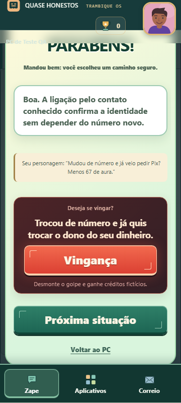
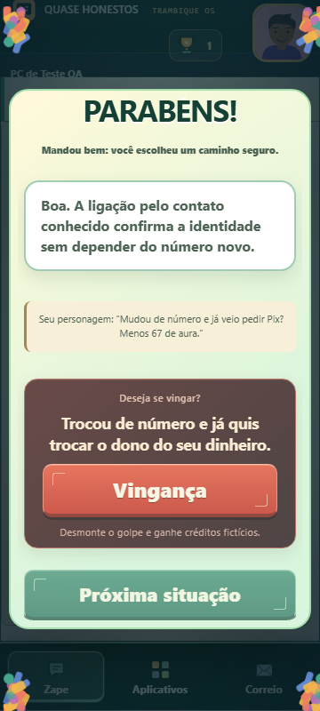
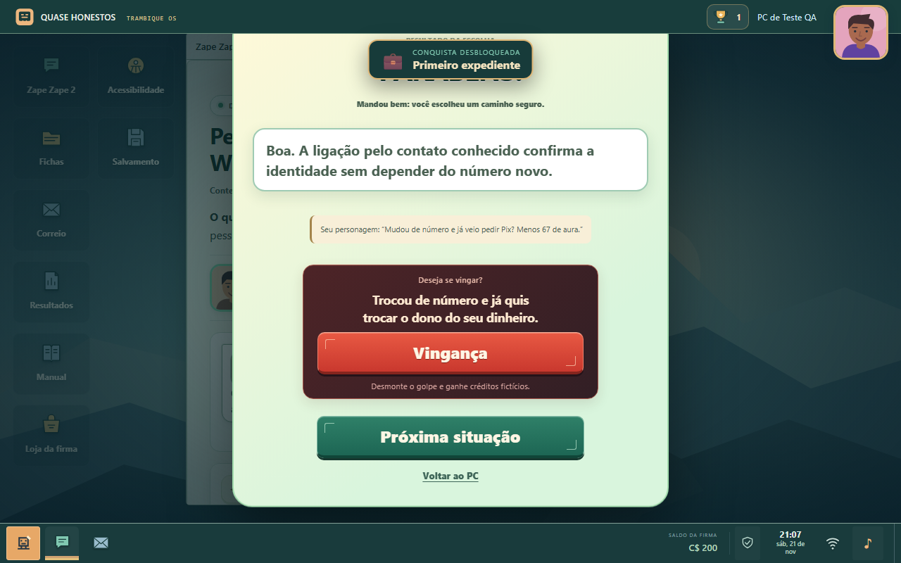
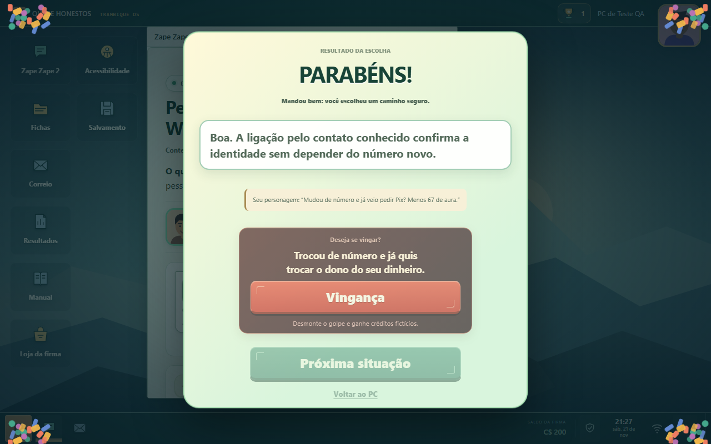
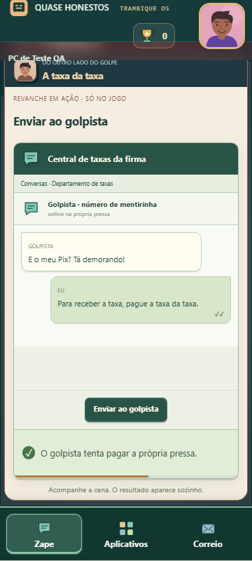
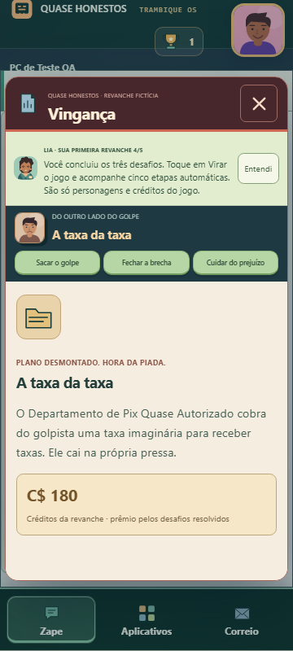
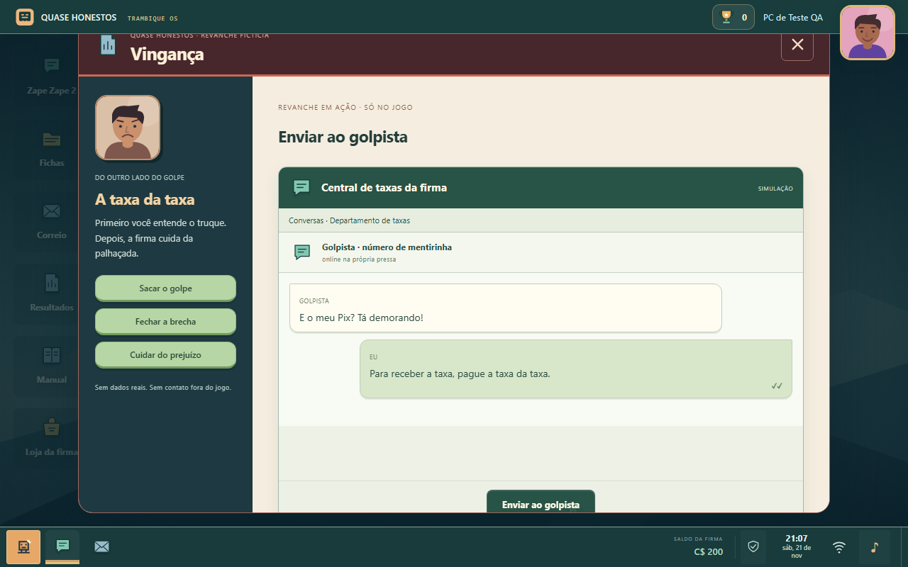
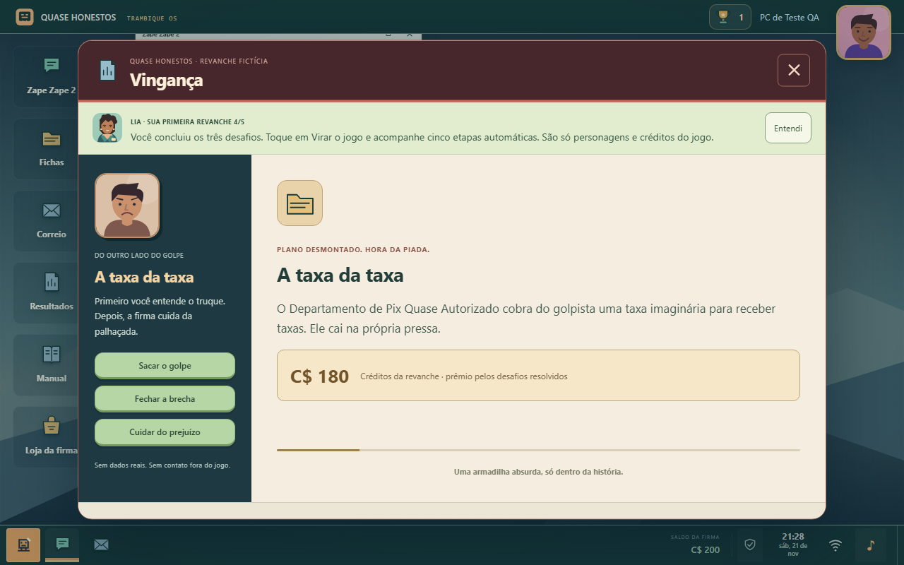

# Revisão de estabilidade visual — 21/11/2026

## Correções confirmadas

1. **Resultado e vingança podiam ser cortados ou posicionados em relação à janela do app.** Reproduzi em Chromium: essas caixas usam posicionamento fixo, mas eram renderizadas dentro da janela do Zape, que tem transformação e recorte próprios. Movi os overlays de resultado, vingança, fundo e confete para o contêiner da área de trabalho e ajustei seus limites para respeitar cabeçalho, barra de tarefas e área segura do celular.
2. **Ações do resultado podiam ficar abaixo do recorte do painel em telas estreitas.** A área rolável interna era mais alta que o próprio resultado. Limitei a rolagem ao espaço interno disponível; o conteúdo continua rolável e o botão “Próxima situação” pode ser trazido por completo à tela e acionado.

## Testes executados

- `npm test`: **944 aprovados, 0 falhas**.
- `npm run build`: concluído; pacote gerado como `v20261121a`.
- Chromium headless, nos viewports **360×800, 447×900, 768×1024, 1280×800 e 1920×1080**:
  - Resultado: caixa dentro da tela; CTA alcançável dentro do painel por rolagem; “Próxima situação” acionou o avanço; nenhum erro de execução.
  - Vingança: caixa dentro da tela e das barras reservadas; “Voltar ao resultado” fechou a janela; nenhum erro de execução.
  - Abertura e fechamento de Manual e Acessibilidade, fluxo de conversa até resultado e conferência de imagens foram executados na matriz de cinco larguras durante a revisão.
- O guia `CODEX_GUIA_PR.md` não foi encontrado no repositório nem na pasta de trabalho; usei as instruções do pedido e o README.

## Evidências antes/depois

### Resultado em celular (360 px)

| Antes | Depois |
|---|---|
|  |  |

### Resultado em desktop (1280 px)

| Antes | Depois |
|---|---|
|  |  |

### Vingança em celular (360 px)

| Antes | Depois |
|---|---|
|  |  |

### Vingança em desktop (1280 px)

| Antes | Depois |
|---|---|
|  |  |

## Arquivos alterados

- `src/game.js` — posiciona overlays fora da janela transformada.
- `src/conversation-ui.css` — limites seguros para resultado, vingança e rolagem das ações.
- `scripts/build.mjs` e `worker/index.js` — identificador do build e alias da versão para atualização coerente dos assets.
- `tests/overlay-layering.test.mjs` e `tests/worker.test.mjs` — regressões para a camada de overlays, limites e alias.
- Este relatório e oito capturas de evidência antes/depois.

## Não testado / limitações

- Não testei em aparelhos físicos, Firefox, Safari ou leitores de tela reais. Os tamanhos foram simulados em Chromium headless; isso não certifica acessibilidade integral em hardware.
- Não alterei conteúdo educativo, idades, casos, vinganças, salvamento ou equilíbrio do jogo.
- Não encontrei outros defeitos reproduzíveis neste escopo durante os fluxos verificados. Isso não equivale a garantir ausência de qualquer bug.

## Sugestões separadas das correções

- Fazer uma rodada posterior com NVDA/VoiceOver e ao menos um Android/iPhone físico, caso haja tempo antes de uma versão final.
- Validar as mesmas telas em Firefox e Safari.
